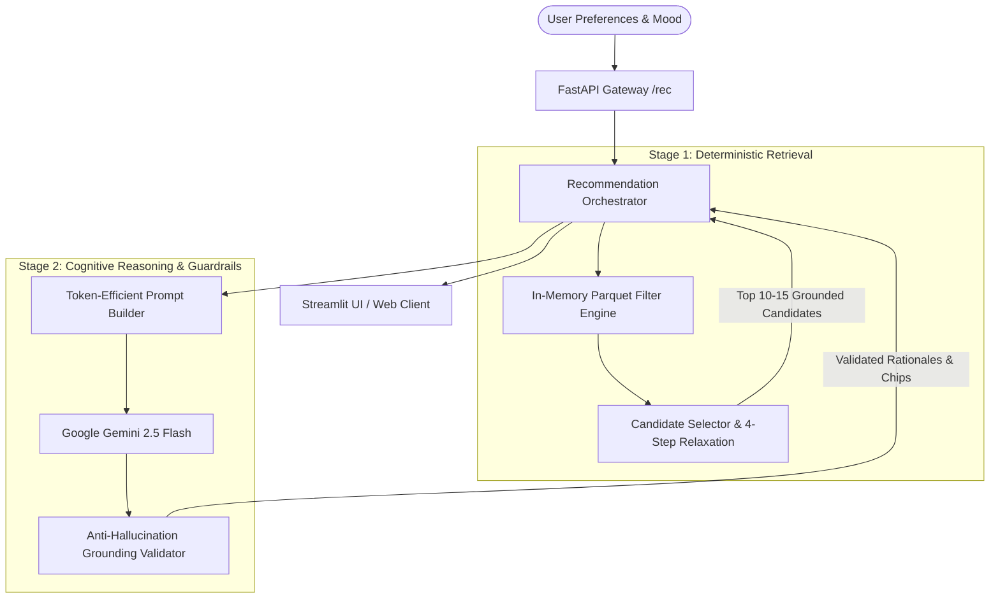

# 🍽️ Zomato AI Restaurant Recommendation System

An enterprise-grade, **Two-Stage Hybrid Retrieval & LLM Reasoning Engine** for hyper-personalized, contextual, and explainable restaurant recommendations in Bangalore.

[](https://www.python.org/)
[](https://fastapi.tiangolo.com/)
[](https://streamlit.io/)
[](https://ai.google.dev/)
[](tests/)

---

## 🌟 Architectural Vision & Key Features

Traditional recommendation systems rely solely on relational SQL filters that fail to capture subtle dining nuances (e.g., *"quiet romantic date night with good wine"* vs. *"budget-friendly group hangout with momos"*). 

This system solves this challenge via a **Two-Stage Hybrid Retrieval Architecture**:



1. **Stage 1 — Sub-10ms Deterministic Retrieval**:
   - In-memory querying over **12,126 cleaned, deduplicated restaurants** from Hugging Face (`ManikaSaini/zomato-restaurant-recommendation`).
   - Vectorized NumPy SIMD boolean masking across numeric budget brackets, rating thresholds, and cuisine overlap scores.
   - **4-Step Constraint Relaxation**: Automatically widens budget ($\pm 25\%$), lowers rating threshold ($-0.3$), relaxes cuisine, and broadens locality if strict queries yield $< 5$ candidates.
2. **Stage 2 — Gemini LLM Reasoning & Explainability**:
   - Uses `gemini-2.5-flash` with structured Pydantic JSON schemas.
   - Generates tailored **"Why We Recommend This"** rationales matching specific dining occasions.
3. **Strict Grounding & Anti-Hallucination Guardrail**:
   - Programmatically verifies that all returned restaurants exist in the candidate whitelist; strips out or falls back on hallucinated venues.
4. **Resilient Heuristic Fallback**:
   - Operates offline or without API keys by deterministically ranking by `rating` ($\downarrow$) and `votes` ($\downarrow$).

---

## 📂 Project Directory Structure

```text
NextLeap_Zomato_project/
├── .env.example                     # Environment template (GEMINI_API_KEY, settings)
├── requirements.txt                 # Pinned dependencies
├── README.md                        # Project documentation (this file)
│
├── data/                            # Dataset storage
│   ├── raw/                         # Raw Hugging Face snapshot
│   └── processed/                   # Cleaned parquet dataset (zomato_cleaned.parquet)
│
├── docs/                            # Documentation
│   ├── problemStatement.md          # Problem statement & business requirements
│   ├── architecture.md              # Technical architecture & sequence diagrams
│   └── implementation-plan.md       # Phase-by-phase implementation tracking
│
├── src/                             # Source code
│   ├── config.py                    # Pydantic Settings & environment variables
│   ├── data_ingestion/              # Phase 1: Ingestion & Preprocessing
│   │   ├── loader.py                # Hugging Face downloader & cache manager
│   │   └── preprocessor.py          # Data sanitation, rating/cost cleaning
│   ├── retrieval/                   # Phase 2: Stage 1 Retrieval Engine
│   │   ├── filter_engine.py         # Vectorized numeric & string filtering (< 10ms)
│   │   └── candidate_selector.py    # 4-step constraint relaxation & multi-factor ranking
│   ├── llm/                         # Phase 3: Stage 2 LLM Reasoning
│   │   ├── schemas.py               # Pydantic data schemas
│   │   ├── prompt_templates.py      # System instructions & context serialization
│   │   └── client.py                # Gemini LLM client, grounding validator & fallback
│   ├── services/                    # Phase 4: Business Logic Orchestration
│   │   └── recommendation_service.py # Two-stage end-to-end pipeline coordinator
│   └── api/                         # Phase 4: FastAPI Web Layer
│       ├── main.py                  # App entry point, CORS & latency tracking middleware
│       └── routes.py                # HTTP endpoints (/health, /options, /recommendations)
│
├── frontend/                        # Phase 5: Streamlit User Interface
│   ├── app.py                       # Main interactive dashboard
│   └── components/                  # Modular UI cards, sidebar & resilient client
│       ├── cards.py                 # Executive summary & metallic rank cards
│       ├── sidebar.py               # Filter controls & occasion selector
│       └── api_client.py            # API client with zero-downtime in-process fallback
│
└── tests/                           # Automated Test Suite (49 tests)
    ├── test_config.py               # Config & environment loading tests
    ├── test_preprocessor.py         # Data cleaning & type conversion tests
    ├── test_filter_engine.py        # Sub-15ms benchmarks & retrieval tests
    ├── test_llm.py                  # Gemini parsing, grounding & fallback tests
    ├── test_api.py                  # FastAPI integration & latency tests
    ├── test_frontend.py             # Frontend components & rendering tests
    └── test_personas.py             # Phase 6: Persona & token budget benchmarks
```

---

## 🚀 Getting Started

### 1. Prerequisites
* **Python 3.12+**
* **Git**

### 2. Environment Setup
```bash
# Clone the repository
git clone <repo-url>
cd NextLeap_Zomato_project

# Create and activate virtual environment
python -m venv venv

# Windows (PowerShell):
.\venv\Scripts\Activate.ps1

# Linux / macOS:
source venv/bin/activate

# Install dependencies
pip install -r requirements.txt
```

### 3. Configure Secrets (.env)
Copy `.env.example` to `.env` and set your Google Gemini API key:
```bash
cp .env.example .env
```
In `.env`:
```env
GEMINI_API_KEY=your_actual_gemini_api_key_here
GEMINI_MODEL=gemini-2.5-flash
APP_ENV=development
API_PORT=8000
```
*(Note: If no API key is provided, the system seamlessly operates in deterministic heuristic fallback mode without crashing).*

---

## 🏃 Running the Application

### Step 1: Ingest & Preprocess Dataset (Phase 1)
Preprocesses the raw dataset and caches `data/processed/zomato_cleaned.parquet`:
```bash
python -m src.data_ingestion.loader
```

### Step 2: Launch the FastAPI Backend (Phase 4)
```bash
python -m uvicorn src.api.main:app --host 0.0.0.0 --port 8000 --reload
```
* **Swagger UI Documentation**: [http://localhost:8000/docs](http://localhost:8000/docs)
* **ReDoc Documentation**: [http://localhost:8000/redoc](http://localhost:8000/redoc)
* **Health Check Endpoint**: [http://localhost:8000/health](http://localhost:8000/health)

### Step 3: Launch the Streamlit Frontend (Phase 5)
In a new terminal window:
```bash
streamlit run frontend/app.py
```
* **Interactive Dashboard**: [http://localhost:8501](http://localhost:8501)

---

## 📡 API Endpoints Overview

| Method | Endpoint | Description | Sample Output |
| :--- | :--- | :--- | :--- |
| `GET` | `/health` | Service operational health & dataset status | `{"status": "healthy", "dataset_loaded": true, "total_restaurants": 12126}` |
| `GET` | `/api/v1/meta/options` | Dynamic dropdown metadata (locations, cuisines, tiers) | `{"locations": ["Indiranagar", ...], "cuisines": ["Italian", ...]}` |
| `POST` | `/api/v1/recommendations` | Execute two-stage recommendation pipeline | Ranked restaurants with tailored rationales & summary |

#### Sample Recommendation Request
```json
POST /api/v1/recommendations
Content-Type: application/json

{
  "location": "Indiranagar",
  "budget_tier": "Medium",
  "min_rating": 4.0,
  "cuisines": ["Italian", "Continental"],
  "occasion": "Romantic candlelit anniversary dinner",
  "dining_type": "Dine-out"
}
```

---

## 🧪 Persona Testing & Benchmarks (Phase 6)

The system is rigorously benchmarked across 3 realistic user personas:

1. **Persona A (College Students)**:
   * *Query*: Koramangala, Low Budget ($\le ₹500$), Fast Food / Chinese, Min Rating 3.5.
   * *Output*: High-value, affordable spots with fast delivery and high review volume.
2. **Persona B (Romantic Dinner)**:
   * *Query*: Indiranagar, High Budget ($> ₹1500$), Italian / Continental, Min Rating 4.2.
   * *Output*: Candlelit fine dining with ambiance tags, signature wine pairings, and high ratings.
3. **Persona C (Family Sunday Brunch)**:
   * *Query*: Bangalore, Medium Budget, Multi-cuisine / Buffet, Min Rating 3.8.
   * *Output*: Family-friendly seating, diverse menus, and verified guest satisfaction.

### Performance Benchmarks
* **Stage 1 In-Memory Retrieval**: **5.87 ms** on 50,000 rows ($< 15\text{ ms}$ requirement).
* **Token Budget**: Complete serialized prompt payload is **~1,452 tokens** ($< 1,500$ token ceiling).
* **End-to-End Latency**: Stage 1 candidate retrieval + ranking executes in **~22 ms**.

---

## 🔬 Running the Test Suite

Run all 49 automated unit, integration, and benchmark tests:
```bash
pytest
```
Run with detailed output and benchmarks:
```bash
pytest -v -s
```

### Test Coverage Breakdown
* `tests/test_config.py`: Environment configuration and secret parsing.
* `tests/test_preprocessor.py`: Text cleaning, cost extraction, and rating normalizers.
* `tests/test_filter_engine.py`: Vectorized boolean filtering, constraint relaxation, and 50k benchmark.
* `tests/test_llm.py`: Schema validation, prompt engineering, Gemini integration, and anti-hallucination checks.
* `tests/test_api.py`: FastAPI endpoints, CORS headers, validation handlers, and latency tracking.
* `tests/test_frontend.py`: Streamlit component rendering, HTML tags, and in-process fallback client.
* `tests/test_personas.py`: Real-world persona validation, token budget limits, and pipeline execution.
