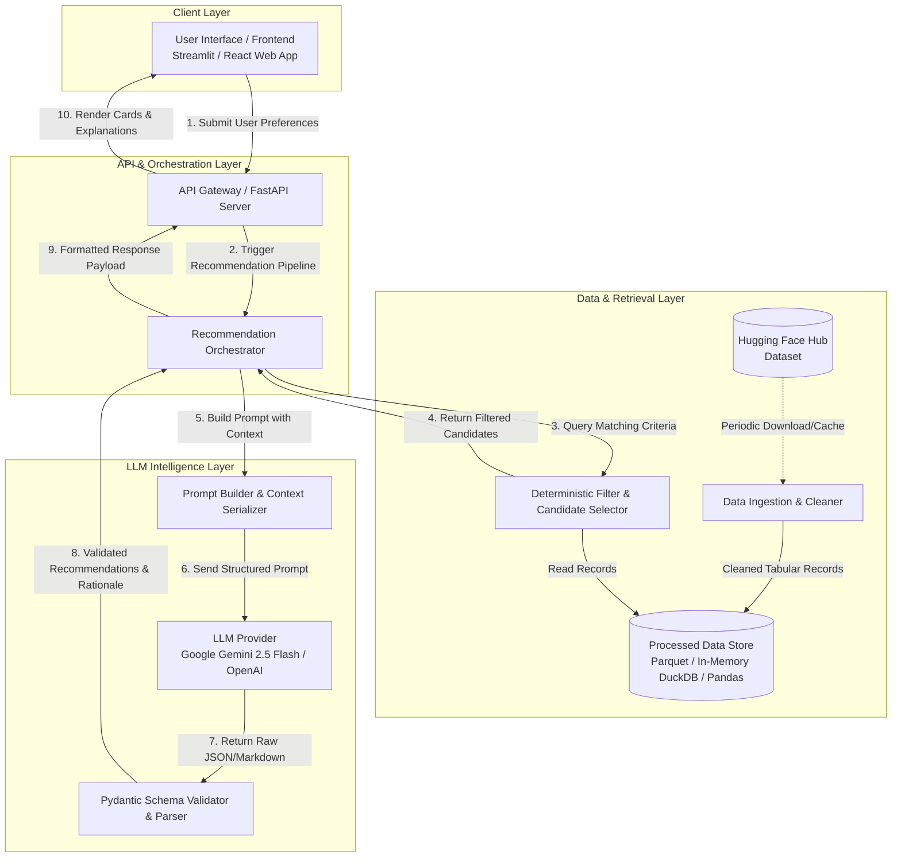
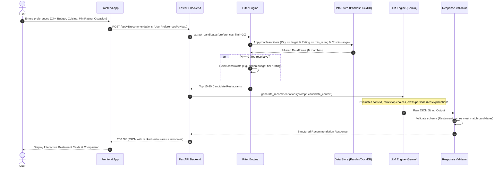

# System Architecture: AI-Powered Restaurant Recommendation System

## 1. Executive Summary & Architectural Vision

The **AI-Powered Restaurant Recommendation System** is designed to provide hyper-personalized, contextual, and explainable dining suggestions. Unlike traditional recommendation engines that depend solely on SQL-like database filtering, this architecture implements a **Two-Stage Hybrid Retrieval & Reasoning Pipeline**:

1. **Stage 1: Deterministic Retrieval & Pre-filtering**: Fast, tabular subset selection using in-memory indexed data (location, budget bands, minimum ratings, cuisine overlap).
2. **Stage 2: Cognitive Reasoning & Re-Ranking (LLM)**: Deep evaluation of candidate restaurants against user constraints, intent, and subtle situational preferences (e.g., ambiance, quick bite, family-friendly) with transparent justification.

---

## 2. High-Level System Architecture



---

## 3. End-to-End Sequence Diagram



---

## 4. Architectural Layers & Subsystems

### 4.1. Data Ingestion & Preprocessing Subsystem
* **Source**: Hugging Face Dataset: [`ManikaSaini/zomato-restaurant-recommendation`](https://huggingface.co/datasets/ManikaSaini/zomato-restaurant-recommendation).
* **Ingestion Worker**:
  * Downloads dataset snapshot and stores locally in a partitioned columnar format (`.parquet`).
  * Normalizes and cleans critical features:
    * **Cost Normalization**: Extracts numeric currency values from strings like `"₹800 for two"` $\rightarrow$ `800`.
    * **Rating Normalization**: Standardizes non-standard ratings (`"NEW"`, `"-"`, missing) to null or baseline values; converts `"4.1/5"` to `4.1` (float).
    * **Cuisine Parsing**: Splits comma-delimited strings into clean, standardized arrays (e.g., `["North Indian", "Mughlai", "Biryani"]`).
    * **Location Standardization**: Cleans whitespace, standardizes city/neighborhood names.

### 4.2. Deterministic Filtering Subsystem (Stage 1)
To avoid high token costs, excessive latency, and LLM attention drift, the system **never passes the entire dataset** to the LLM.
* **Filter Criteria**:
  * `City / Locality`: Case-insensitive substring or exact match.
  * `Budget Range`: Maps user categories (`Low` $\le 500$, `Medium` $500\text{–}1500$, `High` $> 1500$ for two) into numeric bounds.
  * `Minimum Rating`: Filtering out restaurants below user-defined threshold (e.g., $\ge 3.8$).
  * `Cuisine Overlap`: Jaccard or set intersection score between desired cuisines and restaurant offerings.
* **Fallback Strategy (Zero-Result Handling)**:
  * If initial filtering yields $< 5$ candidates, the engine automatically relaxes the constraints in order:
    1. Expand budget boundary by $\pm 25\%$.
    2. Lower rating threshold by $0.3$.
    3. Match related cuisines.

### 4.3. Prompt Engineering & LLM Reasoning Engine (Stage 2)
* **LLM Engine**: Google Gemini API (`gemini-2.5-flash` recommended for low-latency, high reasoning quality, and cost efficiency).
* **Prompt Structure & Guardrails**:
  1. **Role & Persona**: Culinary advisor and expert local food guide.
  2. **Strict Grounding Rule**: The LLM is **strictly prohibited from hallucinating or inventing restaurants**. It must pick and rank exclusively from the provided candidate list.
  3. **Context Injection**: Serializes candidates into clean, concise JSON records with only pertinent columns.
  4. **Output Schema Enforcement**: Uses Structured Outputs (JSON Schema / Pydantic) to guarantee reliable parsing.

#### Example Output Schema
```json
{
  "recommendations": [
    {
      "rank": 1,
      "restaurant_name": "Toscano",
      "cuisine": "Italian, Continental",
      "rating": 4.4,
      "cost_for_two": 1500,
      "location": "Indiranagar, Bangalore",
      "why_recommended": "Perfect match for your romantic Italian dinner preference. It features upscale European ambiance, handcrafted pasta, and fits within your medium-to-high budget.",
      "highlights": ["Great Wine Selection", "Romantic Ambiance", "Outdoor Seating"]
    }
  ],
  "executive_summary": "We prioritized authentic Italian dining spots in Indiranagar with high ambiance ratings, selecting Toscano as the top pick for its romantic setting."
}
```

---

## 5. Recommended Project Directory Structure

```
NextLeap_Zomato_project/
├── .env.example                     # Environment variables (GEMINI_API_KEY, etc.)
├── .gitignore                       # Git ignore patterns
├── README.md                        # Project setup & run guide
├── requirements.txt                 # Project dependencies
│
├── docs/                            # Documentation
│   ├── problemstatement.txt         # Original raw requirements
│   ├── problemStatement.md          # Formatted project problem statement
│   └── architecture.md              # Detailed technical architecture (this document)
│
├── data/                            # Data artifacts
│   ├── raw/                         # Raw cached data from Hugging Face
│   └── processed/                   # Cleaned parquet files for fast loading
│
├── src/                             # Source application code
│   ├── __init__.py
│   ├── config.py                    # App configuration, settings & env vars
│   │
│   ├── data_ingestion/              # Data loading & cleaning pipeline
│   │   ├── __init__.py
│   │   ├── loader.py                # Hugging Face dataset fetching logic
│   │   └── preprocessor.py          # Data sanitation, type conversion, cleaning
│   │
│   ├── retrieval/                   # Stage 1 deterministic filtering
│   │   ├── __init__.py
│   │   ├── filter_engine.py         # Boolean & range filtering logic
│   │   └── candidate_selector.py    # Relaxation fallback & ranking before LLM
│   │
│   ├── llm/                         # Stage 2 LLM inference & prompting
│   │   ├── __init__.py
│   │   ├── client.py                # Gemini API client wrapper
│   │   ├── prompt_templates.py      # System prompts, role definitions & templates
│   │   └── schemas.py               # Pydantic schemas for LLM structured output
│   │
│   ├── services/                    # Business logic orchestration
│   │   ├── __init__.py
│   │   └── recommendation_service.py # End-to-end recommendation flow
│   │
│   └── api/                         # Backend API layer
│       ├── __init__.py
│       ├── main.py                  # FastAPI entry point
│       └── routes.py                # Endpoints (/health, /recommend, /filters)
│
├── frontend/                        # User interface
│   ├── app.py                       # Streamlit web interface
│   └── components/                  # UI components (restaurant cards, filters)
│
└── tests/                           # Unit and integration tests
    ├── test_preprocessor.py
    ├── test_filter_engine.py
    └── test_llm_service.py
```

---

## 6. Security, Resilience & Quality Attributes

| Concern | Architectural Strategy |
| :--- | :--- |
| **Hallucination Prevention** | Candidate whitelist verification; programmatic validation ensures all output names exist in the candidate pool. |
| **Latency Optimization** | In-memory candidate filtering takes $<10\text{ ms}$; token payload is kept under $2\text{k}$ tokens, allowing LLM responses in $<2\text{ s}$. |
| **API Cost Optimization** | Restricting candidate lists to top 15 items limits input token overhead; query caching avoids redundant LLM calls. |
| **Resilience & Graceful Degradation** | If the LLM call times out or encounters rate limits, the system falls back to a deterministic heuristic ranking (e.g. highest rating/review count). |
| **Config & Secret Management** | Strict separation of secrets via environment variables (`.env`) with `.env.example` committed to source control. |

---

## 7. Implementation Roadmap

1. **Phase 1: Ingestion & Preprocessing**
   - Create `data_ingestion/loader.py` and `preprocessor.py`.
   - Ingest Hugging Face dataset, clean attributes, and export clean parquet dataset.
2. **Phase 2: Candidate Filtering Engine**
   - Implement `filter_engine.py` with multi-dimensional filtering and constraint relaxation.
   - Unit test candidate retrieval performance and accuracy.
3. **Phase 3: LLM Reasoning & Prompt Pipeline**
   - Setup `client.py` using Google GenAI SDK (Gemini).
   - Write system prompts with anti-hallucination guardrails and JSON schema parsing.
4. **Phase 4: API & Orchestration**
   - Expose FastAPI endpoints for preference querying.
   - Combine retrieval + LLM reasoning into unified service.
5. **Phase 5: Frontend UI & Polish**
   - Build Streamlit user interface featuring filter controls, real-time results, and recommendation cards.
