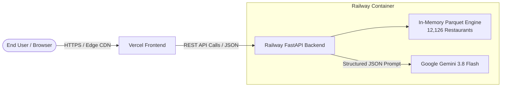

# 🚀 Deployment Plan: Zomato AI Restaurant Recommendation System

This guide outlines the end-to-end production deployment strategy for the **Zomato AI Restaurant Recommendation System**:
- **Backend**: [FastAPI](https://fastapi.tiangolo.com/) hosted on **[Railway](https://railway.app/)**
- **Frontend**: Web Client hosted on **[Vercel](https://vercel.com/)**

---

## 🏗️ Architecture & Deployment Topology



### Key Considerations:
1. **In-Memory Dataset**: The processed parquet file (`data/processed/zomato_cleaned.parquet`) is only **2.64 MB**. It should either be committed to Git or generated during the build step.
2. **Stateless Backend**: FastAPI serves stateless HTTP endpoints (`/health`, `/api/v1/meta/options`, `/api/v1/recommendations`), which scale smoothly on container platforms like Railway.
3. **Frontend Platform Matching**:
   - **Vercel** is an edge/serverless platform designed for static HTML/JS/CSS, React, Vue, Next.js, and Single Page Applications.
   - **Streamlit** requires persistent WebSockets and long-lived Python server processes. For Streamlit, the recommended zero-config platform is **Streamlit Community Cloud** or deploying as a second service on **Railway**. For Vercel, the modern interactive web client (`stitch_zomato_ai_culinary_concierge`) is the natural fit.

---

## 📦 Phase 1: Repository Configuration Files

Before deploying to Railway and Vercel, create the deployment configuration files in your repository.

### 1.1 Railway Configuration Files

#### Create `Procfile` (in repository root)
Railway automatically detects a `Procfile` for running Python applications:
```text
web: uvicorn src.api.main:app --host 0.0.0.0 --port ${PORT:-8000}
```

#### Create `railway.json` (in repository root)
Provides explicit build and deploy instructions:
```json
{
  "$schema": "https://railway.app/railway.schema.json",
  "build": {
    "builder": "NIXPACKS"
  },
  "deploy": {
    "startCommand": "uvicorn src.api.main:app --host 0.0.0.0 --port ${PORT:-8000}",
    "healthcheckPath": "/health",
    "healthcheckTimeout": 60,
    "restartPolicyType": "ON_FAILURE",
    "restartPolicyMaxRetries": 3
  }
}
```

#### Ensure Dataset is Included in Git
In `.gitignore`, update lines 21-22 so the clean dataset (`2.64 MB`) is tracked and uploaded to Railway:
```gitignore
# Data files
data/raw/*
!data/raw/.gitkeep
data/processed/*
!data/processed/zomato_cleaned.parquet
```

---

## 🚂 Phase 2: Deploying Backend to Railway

### Step 2.1: Create a Railway Project
1. Log in to [Railway.app](https://railway.app/) using your GitHub account.
2. Click **"New Project"** → Select **"Deploy from GitHub repo"**.
3. Select your `NextLeap_Zomato_project` repository.
4. Click **"Deploy Now"**.

### Step 2.2: Configure Environment Variables
In the Railway dashboard, navigate to your service's **"Variables"** tab and add:

| Variable Name | Recommended Value | Description |
| :--- | :--- | :--- |
| `GEMINI_API_KEY` | `AIzaSy...` | Your Google AI Studio API key |
| `GEMINI_MODEL` | `gemini-3.8-flash` | Gemini model name |
| `MAX_CANDIDATES_FOR_LLM` | `5` | Keeps prompt token budget low & fast |
| `LLM_TEMPERATURE` | `0.2` | Structured reasoning consistency |
| `APP_ENV` | `production` | Deployment environment |
| `API_HOST` | `0.0.0.0` | Bind host |
| `DEBUG` | `False` | Disable debug stacktraces in prod |

*(Note: Railway automatically injects the `PORT` variable. Do not hardcode `PORT=8000` in Railway).*

### Step 2.3: Generate a Public Domain
1. In the service dashboard, go to the **"Settings"** tab.
2. Scroll to the **"Networking"** section.
3. Click **"Generate Domain"** (e.g., `https://zomato-ai-backend-production.up.railway.app`).
4. Copy this URL.

### Step 2.4: Verify Backend Health
Open the health check endpoint in your browser:
```text
https://<your-railway-domain>/health
```
Expected response:
```json
{
  "status": "healthy",
  "dataset_loaded": true,
  "total_restaurants": 12126,
  "gemini_model": "gemini-3.8-flash",
  "gemini_configured": true,
  "environment": "production"
}
```
Also verify the interactive documentation: `https://<your-railway-domain>/docs`.

---

## 🌐 Phase 2B: Alternative Backend Deployment to Render (Free Tier)

Render is a popular cloud host that offers a **Free Web Service** tier that fully supports Python 3.12, FastAPI, and in-memory Parquet querying.

### Option 1: 1-Click Blueprint Deployment (Recommended)
1. Sign in to [Render.com](https://render.com/) with GitHub.
2. Click **"New +"** → **"Blueprint"**.
3. Connect your `restoSearchBengaluru` repository.
4. Render automatically detects [`render.yaml`](file:///d:/Dipti/NextLeap_Zomato_project/render.yaml) and configures the build, health check, and environment.
5. In the secret prompt, enter your `GEMINI_API_KEY`.
6. Click **"Apply"**.

### Option 2: Manual Web Service Setup on Render
1. In Render, click **"New +"** → **"Web Service"**.
2. Connect `restoSearchBengaluru`.
3. Set the following settings:
   - **Language**: `Python`
   - **Branch**: `main`
   - **Build Command**: `pip install -r requirements.txt`
   - **Start Command**: `uvicorn src.api.main:app --host 0.0.0.0 --port $PORT`
   - **Instance Type**: `Free`
4. Under **Advanced / Environment Variables**, add:
   - `PYTHON_VERSION`: `3.12.4`
   - `GEMINI_API_KEY`: *(Your Google AI Studio API Key)*
   - `GEMINI_MODEL`: `gemini-3.8-flash`
   - `MAX_CANDIDATES_FOR_LLM`: `5`
   - `APP_ENV`: `production`
5. Click **"Deploy Web Service"**.
6. Copy your public Render URL (e.g., `https://zomato-ai-backend.onrender.com`).

> [!NOTE]
> Render's Free tier services spin down after 15 minutes of inactivity. When a new search is made after dormancy, the first request may take 30–50 seconds to warm up. Subsequent searches run at normal sub-second speeds.

---

## ⚡ Phase 3: Deploying Frontend to Vercel

### Approach A: Deploying the Modern Web Client (`stitch_zomato_ai_culinary_concierge`) [Recommended for Vercel]

The repository includes a modern, responsive web application (`stitch_zomato_ai_culinary_concierge/code.html`).

#### Step 3.1: Prepare Vercel Static Directory
1. Ensure the frontend folder contains an `index.html` referencing your Railway API URL:
   ```javascript
   const API_BASE_URL = window.location.hostname === "localhost" 
     ? "http://localhost:8000" 
     : "https://<your-railway-domain>";
   ```
2. Create `vercel.json` in the root (or frontend directory):
   ```json
   {
     "version": 2,
     "cleanUrls": true,
     "routes": [
       { "src": "/(.*)", "dest": "/stitch_zomato_ai_culinary_concierge/code.html" }
     ]
   }
   ```

#### Step 3.2: Deploy on Vercel
1. Log into [Vercel](https://vercel.com/) with GitHub.
2. Click **"Add New..."** → **"Project"**.
3. Import your `NextLeap_Zomato_project` repository.
4. Set **Root Directory** to `./` (or `stitch_zomato_ai_culinary_concierge`).
5. Click **"Deploy"**.
6. Once deployed, Vercel gives you an instant global URL (e.g., `https://zomato-ai-concierge.vercel.app`).

---

### Approach B: Deploying the Streamlit Interface (`frontend/app.py`)

If you prefer deploying the Python Streamlit UI, Streamlit requires a persistent Python process with WebSockets. The two best production options are:

#### Option 1: Streamlit Community Cloud (100% Free & 1-Click)
1. Go to [share.streamlit.io](https://share.streamlit.io/).
2. Select your repository, branch, and set main file path to `frontend/app.py`.
3. In Advanced Settings, add the environment secret:
   ```toml
   API_BASE_URL = "https://<your-railway-domain>"
   ```
4. Click **Deploy**.

#### Option 2: Deploy Streamlit on Railway (Side-by-side with FastAPI)
1. In your Railway project, click **"New"** → **"GitHub Repo"** (same repo).
2. Set custom start command:
   ```bash
   streamlit run frontend/app.py --server.port $PORT --server.address 0.0.0.0 --server.headless true
   ```
3. Set environment variable:
   ```text
   API_BASE_URL=https://<your-fastapi-railway-domain>
   ```

---

## 🔒 Phase 4: Security & Cross-Origin (CORS) Verification

FastAPI is configured with permissive CORS headers in `src/api/main.py`:
```python
app.add_middleware(
    CORSMiddleware,
    allow_origins=["*"],  # Allows Vercel preview and production domains
    allow_credentials=True,
    allow_methods=["*"],
    allow_headers=["*"],
)
```

To restrict CORS strictly to your Vercel domain in production:
```python
allow_origins=[
    "https://zomato-ai-concierge.vercel.app",
    "http://localhost:3000",
    "http://localhost:8501"
]
```

---

## 🧪 Phase 5: Post-Deployment Smoke Test Checklist

Once both services are deployed, test the full system:

- [ ] **1. API Health Check**: `GET https://<railway-domain>/health` returns `200 OK` and `"dataset_loaded": true`.
- [ ] **2. Dropdown Metadata**: `GET https://<railway-domain>/api/v1/meta/options` returns popular locations and cuisines.
- [ ] **3. End-to-End Recommendations**:
  ```bash
  curl -X POST "https://<railway-domain>/api/v1/recommendations" \
       -H "Content-Type: application/json" \
       -d '{"location": "Indiranagar", "budget_tier": "Medium", "cuisines": ["Italian"], "occasion": "Romantic Dinner"}'
  ```
- [ ] **4. Frontend Rendering**:
  - Open Vercel URL in browser.
  - Verify dropdowns populate with Bangalore locations.
  - Execute a search and verify recommendation cards render with ratings, price tags, and rationales.
- [ ] **5. Fallback Resilience**: Verify results load gracefully even during peak Gemini demand spikes.

---

## 🚨 Troubleshooting & Common Gotchas

| Issue | Root Cause | Resolution |
| :--- | :--- | :--- |
| **`FileNotFoundError: data/processed/zomato_cleaned.parquet`** | File was excluded by `.gitignore` | Un-ignore `!data/processed/zomato_cleaned.parquet` in `.gitignore` and commit the 2.64 MB file. |
| **Railway Deploy crashes with `$PORT` binding error** | App was hardcoded to listen on 8000 | Ensure start command uses `--port ${PORT:-8000}`. Railway assigns dynamic ports. |
| **Vercel: CORS Error (Cross-Origin Request Blocked)** | Frontend domain blocked by backend | Verify `allow_origins=["*"]` in `src/api/main.py`. |
| **Vercel 404 on page refresh** | Missing SPA rewrite rules | Add rewrite rule in `vercel.json` pointing `/(.*)` to your entry HTML file. |
| **Recommendations take > 30 seconds** | `MAX_CANDIDATES_FOR_LLM` set too high | Set `MAX_CANDIDATES_FOR_LLM=5` in Railway environment variables. |
