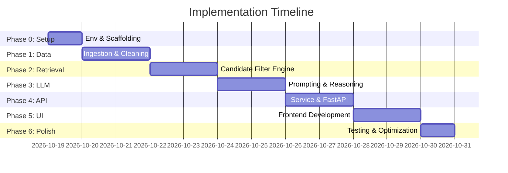

# Phase-Wise Implementation Plan: AI-Powered Restaurant Recommendation System

This implementation plan outlines the sequential, phase-by-phase execution strategy for developing the **AI-Powered Restaurant Recommendation System**. It builds upon the technical architecture specified in [docs/architecture.md](file:///d:/Dipti/NextLeap_Zomato_project/docs/architecture.md) and the project goals outlined in [docs/problemStatement.md](file:///d:/Dipti/NextLeap_Zomato_project/docs/problemStatement.md).

---

## 📅 Roadmap Overview



---

## 🛠️ Phase 0: Project Setup & Environment Scaffolding

### Objective
Establish the repository foundation, directory structure, environment management, and dependency definitions.

### Action Items
1. **Directory Structure Creation**:
   * Create folder hierarchy (`src/`, `data/raw/`, `data/processed/`, `frontend/`, `tests/`, etc.).
2. **Virtual Environment & Dependencies**:
   * Create virtual environment (`python -m venv venv`).
   * Define `requirements.txt` with locked major versions:
     * `datasets>=2.18.0` (Hugging Face)
     * `pandas>=2.2.0`, `pyarrow>=15.0.0`
     * `fastapi>=0.110.0`, `uvicorn>=0.28.0`
     * `google-genai>=0.1.0` (or `google-generativeai>=0.5.0`)
     * `pydantic>=2.6.0`, `pydantic-settings>=2.2.0`
     * `streamlit>=1.32.0`
     * `pytest>=8.0.0`, `httpx>=0.27.0`
     * `python-dotenv>=1.0.0`
3. **Configuration & Secrets Setup**:
   * Implement `src/config.py` using `pydantic-settings` to load:
     * `GEMINI_API_KEY`
     * Data directory paths
     * Default candidate limits and model parameters
   * Create `.env.example` and update `.gitignore`.

### Verification & Deliverables
* [x] Running `python -c "import fastapi, streamlit, google.genai, pandas"` succeeds.
* [x] `src/config.py` correctly reads settings from `.env`.
* [x] `.gitignore` prevents tracking of raw datasets, virtual environments, and `.env`.

---

## 📊 Phase 1: Data Ingestion & Preprocessing Pipeline

### Objective
Fetch the Zomato restaurant dataset from Hugging Face, clean erratic fields, normalize formats, and save an optimized columnar `.parquet` file for high-speed querying.

### Action Items
1. **Dataset Ingestion (`src/data_ingestion/loader.py`)**:
   * Implement automated download from Hugging Face: `ManikaSaini/zomato-restaurant-recommendation`.
   * Add local disk caching to prevent re-downloading on every run.
2. **Data Cleaning & Normalization (`src/data_ingestion/preprocessor.py`)**:
   * **Ratings**:
     * Strip string artifacts (`"4.1/5"` $\rightarrow$ `4.1`).
     * Replace non-numeric values (`"NEW"`, `"-"`, `NaN`) with `None` or appropriate flags.
   * **Cost for Two**:
     * Parse numeric amounts from messy strings (e.g., `"₹800 for two"`, `"800"`, `"1,200"`) into standard integers.
   * **Cuisines**:
     * Clean, strip, and parse into normalized Python lists (e.g., `["North Indian", "Chinese", "Fast Food"]`).
   * **Locations**:
     * Strip whitespace, normalize casing, and separate neighborhood from city where applicable.
3. **Artifact Persistence**:
   * Save the cleaned DataFrame to `data/processed/zomato_cleaned.parquet`.
4. **Unit Testing (`tests/test_preprocessor.py`)**:
   * Test price parser with various string formats.
   * Test rating cleaner with edge-case strings (`"NEW"`, `"-", "3.9/5"`).

### Verification & Deliverables
* [x] `python -m src.data_ingestion.loader` successfully writes `data/processed/zomato_cleaned.parquet`.
* [x] Cleaned dataset has zero unparseable cost values.
* [x] All tests in `tests/test_preprocessor.py` pass.

---

## 🔍 Phase 2: Deterministic Retrieval & Filtering Engine (Stage 1)

### Objective
Implement the fast, in-memory filtering layer that isolates high-relevance restaurant candidates (top 10–20) before invoking the LLM, reducing latency and token costs.

### Action Items
1. **Filtering Engine (`src/retrieval/filter_engine.py`)**:
   * **Location Matching**: Case-insensitive substring and exact locality matching.
   * **Budget Translation**:
     * `Low`: $\le ₹500$ for two
     * `Medium`: $₹500 - ₹1500$ for two
     * `High`: $> ₹1500$ for two
     * Custom numeric ranges.
   * **Minimum Rating Filter**: Filters out restaurants below the threshold (e.g. $\ge 3.8$).
   * **Cuisine Matching**: Prioritizes records with exact or partial cuisine overlap.
2. **Constraint Relaxation Strategy (`src/retrieval/candidate_selector.py`)**:
   * If filtered results count $< 5$:
     * Step 1: Expand budget bounds by $\pm 25\%$.
     * Step 2: Lower minimum rating threshold by $0.3$.
     * Step 3: Match broader cuisine categories.
3. **Context Serialization**:
   * Formats candidate records into compact, token-efficient JSON or Markdown tables containing only essential attributes (`name`, `location`, `rating`, `cost_for_two`, `cuisines`, `highlights`).

### Verification & Deliverables
* [x] Filtering 50,000 rows executes in $< 15\text{ ms}$.
* [x] Edge cases (e.g. strict filters yielding 0 results) trigger graceful relaxation.
* [x] Unit tests in `tests/test_filter_engine.py` pass.

---

## 🧠 Phase 3: LLM Reasoning, Prompt Engineering & Validation (Stage 2)

### Objective
Integrate Google Gemini to analyze candidate restaurants, apply situational reasoning, generate tailored rationales ("why this fits"), and enforce anti-hallucination constraints.

### Action Items
1. **Structured Data Schemas (`src/llm/schemas.py`)**:
   * Define Pydantic models:
     ```python
     class RestaurantRecommendation(BaseModel):
         rank: int
         restaurant_name: str
         cuisine: str
         rating: float
         cost_for_two: int
         location: str
         why_recommended: str
         highlights: list[str]

     class RecommendationResponse(BaseModel):
         recommendations: list[RestaurantRecommendation]
         executive_summary: str
     ```
2. **Prompt Template Engineering (`src/llm/prompt_templates.py`)**:
   * Craft the prompt with:
     * **System Persona**: Expert local culinary guide and concierge.
     * **Strict Anti-Hallucination Guardrail**: Must only select and rank restaurants from the provided candidate list.
     * **Reasoning Directives**: Match user situational constraints (e.g., date night, budget crunch, quick meal, family vibe).
     * **JSON Output Formatting instructions**.
3. **LLM Client Wrapper (`src/llm/client.py`)**:
   * Connect to Gemini API (`gemini-2.5-flash`).
   * Implement structured JSON response parsing and validation.
4. **Grounding Verification & Fallback**:
   * Verify that every restaurant in the response strictly exists in the candidate subset.
   * If Gemini API times out or errors, fallback to deterministic ranking sorted by `rating` and `votes`.

### Verification & Deliverables
* [x] Gemini successfully returns valid JSON matching `RecommendationResponse`.
* [x] Anti-hallucination validation blocks unknown restaurant names.
* [x] Fallback mechanism activates seamlessly if API key is invalid or offline.

---

## 🚀 Phase 4: API Layer & End-to-End Orchestration

### Objective
Build a clean, robust FastAPI application that connects the retrieval engine and the LLM service into unified HTTP endpoints.

### Action Items
1. **Recommendation Service (`src/services/recommendation_service.py`)**:
   * Coordinates the flow:
     `User Preferences` $\rightarrow$ `Filter Engine` $\rightarrow$ `Candidate Selection` $\rightarrow$ `LLM Reasoning` $\rightarrow$ `Final Payload`.
2. **FastAPI Endpoints (`src/api/routes.py` & `src/api/main.py`)**:
   * `GET /health`: Returns service health and dataset status.
   * `GET /api/v1/meta/options`: Returns available cities, unique cuisines, and budget ranges for frontend dropdowns.
   * `POST /api/v1/recommendations`: Accepts `UserPreferencesPayload` and returns `RecommendationResponse`.
3. **Error Handling & Middleware**:
   * Input validation with descriptive error messages.
   * CORS middleware to allow local frontend access.
   * Request logging and latency tracking.

### Verification & Deliverables
* [x] FastAPI documentation accessible at `http://localhost:8000/docs`.
* [x] `POST /api/v1/recommendations` returns full recommendations with rationales in $< 2.5\text{ seconds}$.
* [x] Automated integration tests in `tests/test_api.py` pass.

---

## 🎨 Phase 5: Frontend Development (Streamlit UI)

### Objective
Create an intuitive, modern, and interactive user interface that allows users to customize their preferences and explore personalized recommendations.

### Action Items
1. **Sidebar / Control Panel**:
   * **Location**: Searchable select box of cities / areas.
   * **Budget**: Segmented button or slider (`Low: < ₹500`, `Medium: ₹500–₹1500`, `High: > ₹1500`).
   * **Cuisines**: Multi-select tags (e.g. North Indian, Italian, Chinese).
   * **Minimum Rating**: Slider ($3.0$ to $5.0$).
   * **Occasion / Mood**: Free-text input or chips (e.g. *"Romantic date"*, *"Family dinner"*, *"Quick bite"*, *"Work lunch"*).
2. **Results Display Area**:
   * **Executive Summary**: Callout card summarizing the recommendations.
   * **Ranked Restaurant Cards**:
     * Prominent Restaurant Name and Rank Badge (#1, #2, #3).
     * Rating, Cost for Two, Location, and Cuisine tags.
     * **"Why We Recommend This"** personalized explanation.
     * Highlights chips (e.g. "Rooftop Seating", "Great Cocktails").
3. **UX Polish**:
   * Skeleton loaders / spinner during LLM generation.
   * Empty state messaging with helpful suggestions when no restaurants match.

### Verification & Deliverables
* [x] Streamlit interface launches with `streamlit run frontend/app.py`.
* [x] Form submission fetches recommendations and renders cards dynamically.
* [x] UI handles slow connections and zero-result situations gracefully.

---

## 🧪 Phase 6: System Testing, Optimization & Documentation

### Objective
Perform end-to-end testing, evaluate recommendation quality across realistic user personas, optimize latency, and complete user documentation.

### Action Items
1. **Persona Testing**:
   * **Persona A (College Students)**: Delhi, Budget Low, Fast Food/Momos, Min Rating 3.5.
   * **Persona B (Romantic Dinner)**: Bangalore (Indiranagar), Budget High, Italian, Min Rating 4.2.
   * **Persona C (Family Sunday Brunch)**: Multi-cuisine, Family-friendly, Medium budget.
2. **Performance Benchmarking**:
   * Measure retrieval latency, LLM response time, and total round-trip time.
   * Optimize candidate serialization to keep prompt tokens $< 1500$.
3. **Comprehensive README.md**:
   * Project description & architecture summary.
   * Prerequisites and installation instructions.
   * Step-by-step commands to run data ingestion, API, and UI.

### Verification & Deliverables
* [x] All 3 user personas generate accurate, relevant, hallucination-free recommendations.
* [x] `README.md` allows a fresh user to clone and run the project end-to-end.
* [x] Complete test suite passes with `pytest`.

---

## 📋 Phase-Wise Checklist

| Phase | Milestone | Key Deliverable | Status |
| :--- | :--- | :--- | :--- |
| **Phase 0** | Setup & Scaffold | Project structure, `requirements.txt`, `config.py` | ✅ Completed |
| **Phase 1** | Data Pipeline | Cleaned `data/processed/zomato_cleaned.parquet` | ✅ Completed |
| **Phase 2** | Candidate Retrieval | `filter_engine.py` with constraint relaxation | ✅ Completed |
| **Phase 3** | LLM Engine | Gemini prompt templates, JSON schema & grounding guardrails | ✅ Completed |
| **Phase 4** | Orchestration & API | FastAPI backend with `/recommendations` endpoint | ✅ Completed |
| **Phase 5** | Frontend App | Streamlit interactive recommendation dashboard | ✅ Completed |
| **Phase 6** | QA & Finalization | Persona tests, benchmarking, and final `README.md` | ✅ Completed |
